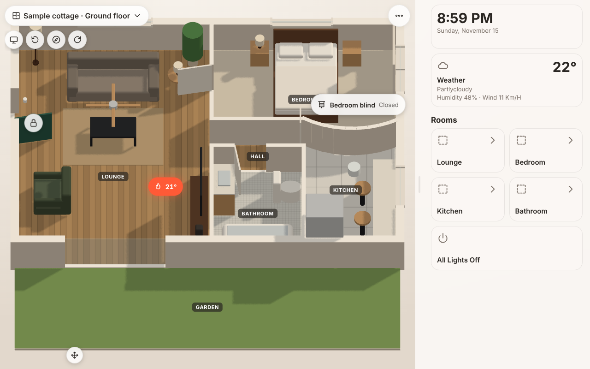
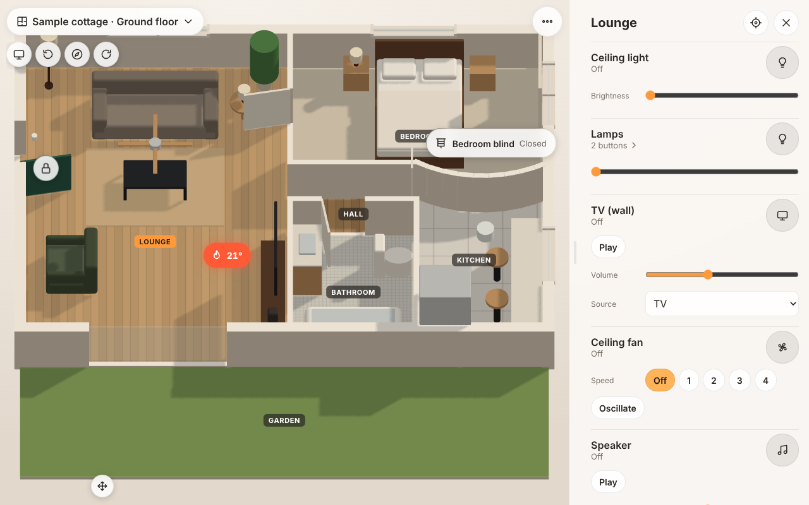
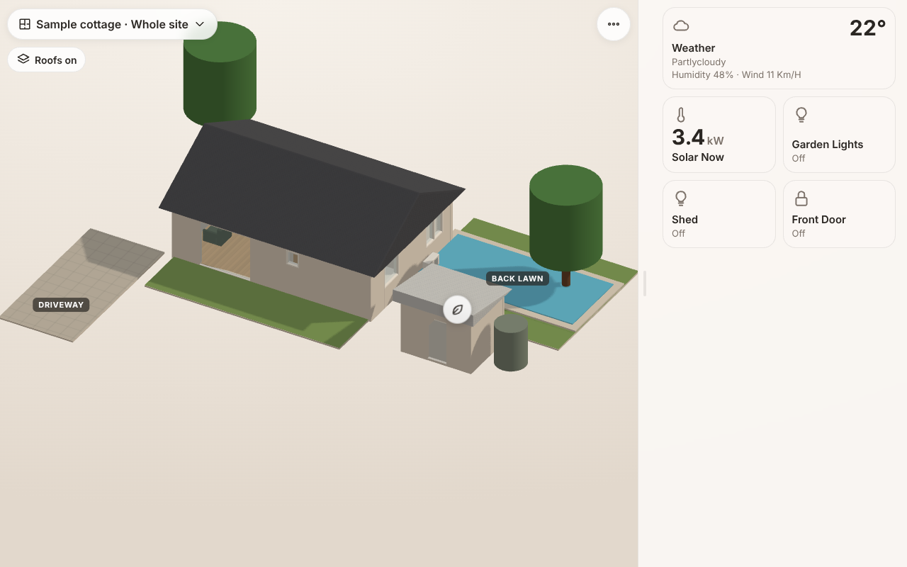
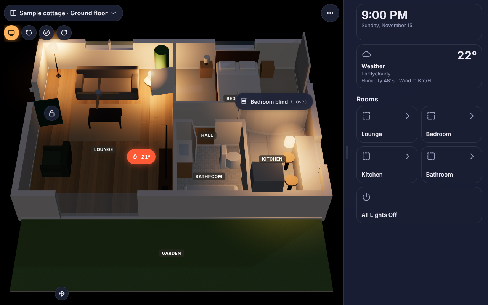
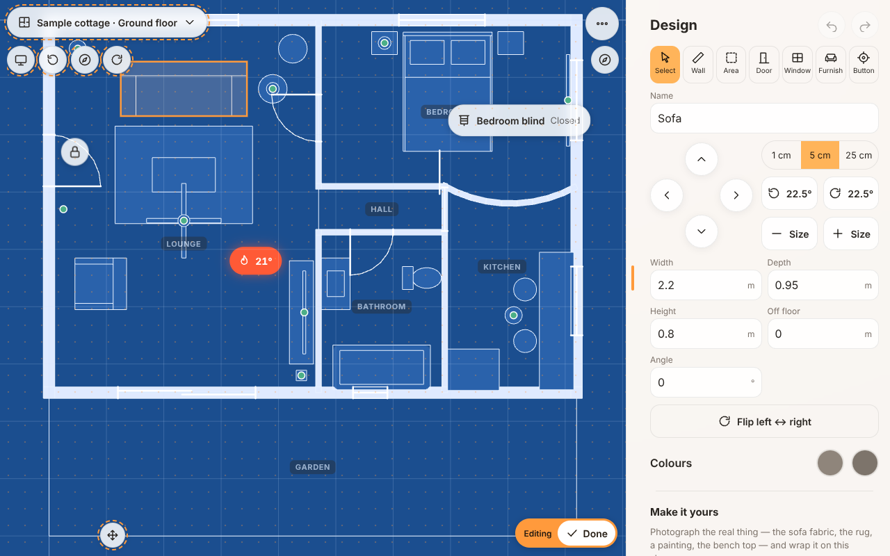
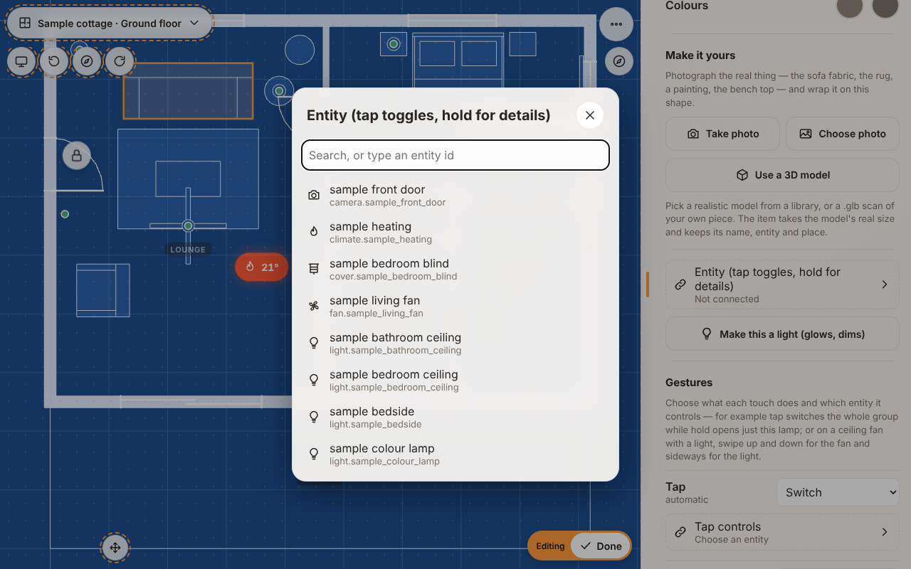
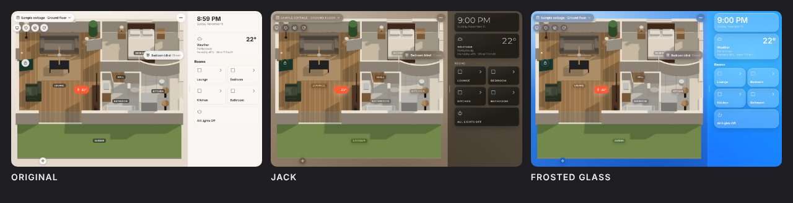
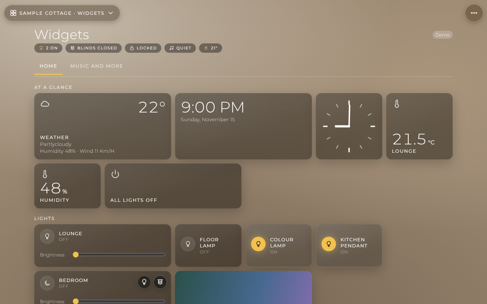
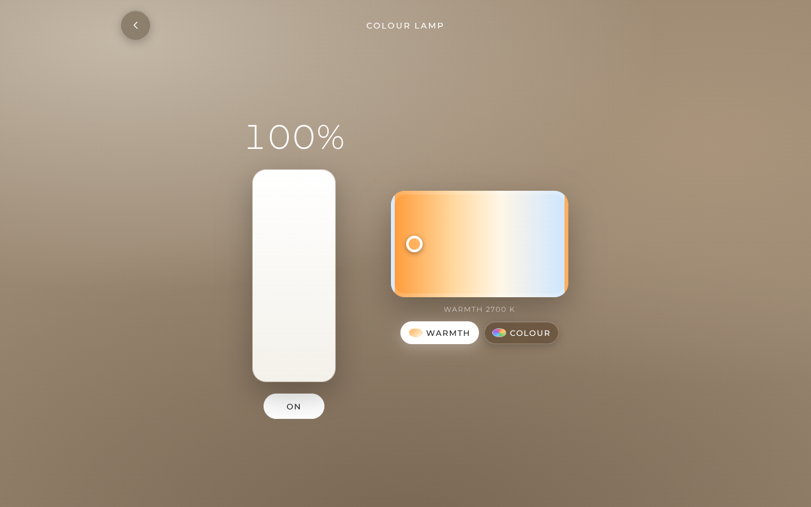

# Nidorama

**Look down into your home and tap the things in it.**

Nidorama is a floor-plan controller for Home Assistant. You draw your home once (or have it
drawn from a rough paper sketch), and every lamp, fan, blind, speaker and thermostat sits where
it really is. Tap a lamp to switch it, swipe to dim it, hold it for everything it can do.

## What it does

- **Your home as a 3D plan.** Walls, doors, windows, curved walls, floors and a furniture
  library. Several levels. Realistic, illustrated, clay, flat-plan and blueprint styles, by day
  and by night.
- **Widgets.** Dashboards of widgets you arrange: weather, clocks, thermostats, calendars,
  music with album art, cameras, readings, rooms and "all lights off", in sections and tabs.
- **Made for a wall tablet.** Runs as the tablet's home screen, keeps the screen on, dims when
  idle, a kiosk mode, and glides back to its own view when left alone.
- **Themes that change the whole look,** including *Jack*: dark glass, thin lettering, and a full
  page for each light with one tall slider and a colour field.
- **Buttons where you want them.** On the plan or beside it, in three sizes, and button groups
  that fan out more buttons.
- **Step lists.** One tap runs several things in order ("Movie time": lights down, TV on).
- **Alerts,** with a one-tap hand-over to a Home Assistant automation.
- **Backups** before every update, saved wherever you like.
- **From a paper sketch.** A guide turns a rough drawing into a plan with the chat assistant of
  your choice.
- **The whole site.** Every building, its roof, and the yard in 3D, with controls for the outside:
  solar, the garden, the pool, the gate.
- **Shared by the household.** With this add-on, every device sees the same homes and changes
  appear on the others within a minute.

## Draw it, then connect it

Edit mode turns the plan into a blueprint: draw walls, doors and windows, drop in furniture,
then tap a lamp or a fan and connect it to the device in Home Assistant.

## Themes

A theme changes the whole look, not only the colours.

## Everything stays at home

Nidorama talks to Home Assistant over your own network. No accounts, no cloud, no tracking.

Also available as an Android app, which finds this add-on by itself. See the Documentation tab
for setting up.
